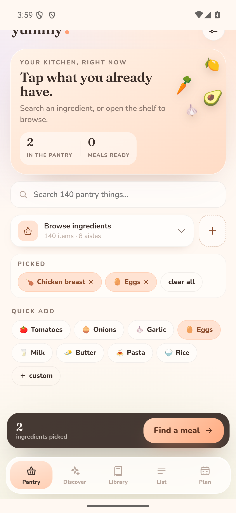
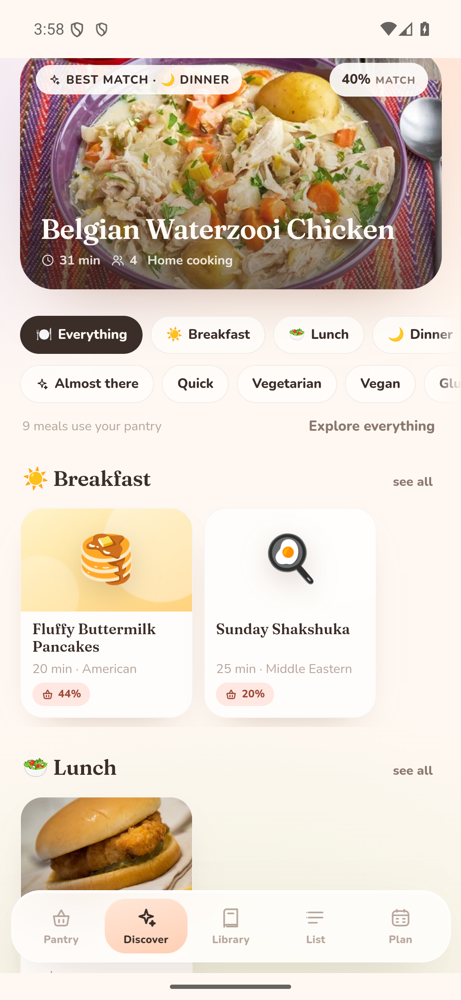
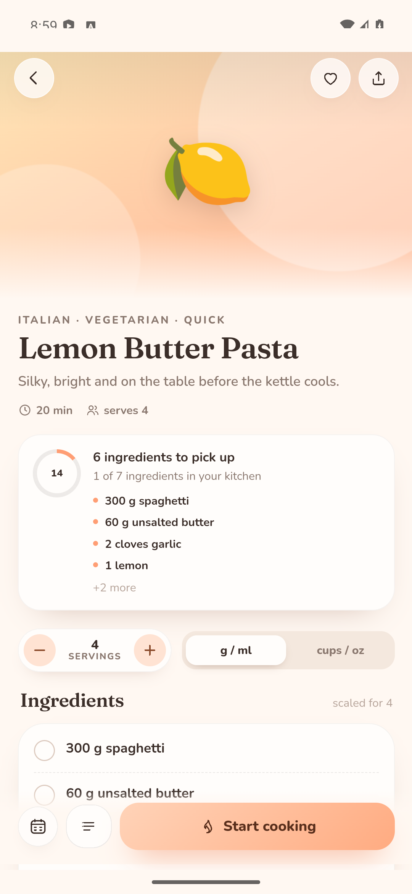

# 🍑 Yummy

A pastel, pantry-first recipe companion for Android. Pick what's already in your kitchen, get honest meal matches, scale them for the table, and cook with big, calm step cards — all offline, all on your phone.

The interface is React + Capacitor; the recipe brain (parsing, scaling, matching, web extraction) is **Rust**, compiled into the APK as `libyummy_core.so` and called over JNI.

| Pantry | Discover | Recipe |
| --- | --- | --- |
|  |  |  |

---

## Install it (sideload)

The signed APK is at **`apk/Yummy-1.2.2.apk`** (24 MB, Android 8+).

1. Copy it to your phone (USB, Drive, `adb push` — whatever is easiest).
2. Open it. Android will ask permission to install from that app — allow it.
3. Install, open Yummy, and tap a few things you actually have in the cupboard.

The APK is a local build artifact and isn't committed to git — build it with the commands below, or download it from the machine that built it.

Or with a phone connected over USB:

```bash
adb install apk/Yummy-1.2.2.apk
```

App id `app.yummy.recipes` · version 1.2.2 · universal APK with `arm64-v8a`, `armeabi-v7a` and `x86_64` native libraries.

### Sharing a recipe from Chrome

Open a recipe page → **Share** → **Yummy**. The share sheet target reads the page in the background and drops you into the editable draft.

---

## What's inside

### Pantry
- A **search-first, collapsible shelf**: the page opens with search and quick-add chips, and the full 140-ingredient tile grid expands only when you want it.
- **Make it yours**: add custom ingredients (name, emoji, aisle) — they appear in the shelf, count as pantry matches for recipes, and can be deleted cleanly at any time.
- Long-press a tile to set **quantity** and a **use-by date** — recipes then warn when you're short and prioritise food that needs eating.
- **Staples** (salt, pepper, oil, flour, sugar, water) can be assumed automatically.
- “Add 8 everyday ingredients” gets a new kitchen started in one tap.

### Discover
- Built around **meal types** rather than dinner-only: Breakfast, Lunch, Dinner, Something sweet and Snacks, each with its own section and best-match hero.
- **Style & diet filters** — Quick, Vegetarian, Vegan, Gluten Free, Low Carb, High Protein, Soup, Pasta, Fish, Meaty, Hearty, One Pan — applied across your library and the web feed.
- **Diverse featured recipes** from TheMealDB: a random selection plus breakfast, pasta and seafood batches, so the feed is never just dessert.
- Tags are derived automatically for scraped recipes (ingredients, name and cooking method) and stored with every recipe.

### Matching
- Every recipe gets a **cook-now score** (`4/5 ready`), the missing items named, and an “Almost there” filter.
- **78 built-in substitutions** (buttermilk → milk + lemon, shallot → onion, crème fraîche → sour cream…) offered only when you actually have the swap ingredients.
- **Honest relevance**: store-cupboard staples never make a recipe a “match” on their own. A dish has to use a lead ingredient, several pantry items, or be a simple/breakfast recipe — apple pie no longer appears because you happen to have an egg.
- Ingredient families understand that chicken breast, thighs and whole chicken are all chicken.
- Ranking blends how many real ingredients you have, match percentage, expiring food and cooking time. Anything that shares no core ingredients moves behind **Explore everything**.

### Web matching
- TheMealDB is queried with your actual pantry ingredients (`filter.php?i=…`), then each result is fetched in full and run through the same Rust matcher. Chicken + eggs now returns chicken curries, sandwiches, roasts and egg breakfasts — not random desserts.
- Matched web recipes are cached on the phone for two hours, so the list keeps working offline.
- The featured rail uses free category and area lists (TheMealDB's `randomselection` endpoint is patron-only as of late 2026) and is no longer hidden by the selected meal type.
- Pantry ids are translated to real TheMealDB ingredient names (pasta → Spaghetti/Penne/Macaroni), and large ingredient lists are sampled rather than read alphabetically — so “Pasta + Garlic” returns carbonara and puttanesca, not the first six A-names.
- Refresh re-fetches both featured picks and matched web recipes, and failures say what actually happened instead of claiming you're offline.
- A separate **Browse more from the web** rail keeps a broader, random selection for inspiration.

### Capture
- **Web link** — Rust reads JSON-LD, microdata and OpenGraph (via CapacitorHttp so there are no CORS walls), then gives you an editable draft.
- **Photo / screenshot** — ML Kit OCR on-device, then Rust heuristics turn the text into ingredients and steps.
- **By hand** — fast form with automatic ingredient parsing (`1½ cups`, `2–3 cloves`, `2 x 400 g cans`).
- **Your own photos** — attach a dish photo to anything you save (or to a seed recipe later): it's resized to 1400px, compressed and stored on the phone. Tap the camera on a saved recipe to change it.
- Everything lands in an editable draft before it's saved.

### Cooking
- **Servings scaler** that keeps kitchen maths sane: animated amounts, proper fractions, eggs/lemons rounded with a note, pan-size and seasoning hints.
- Metric ↔ imperial toggle with per-ingredient cup weights; spoon measures stay spoons.
- **Cook mode**: one step at a time in large type, ingredient checklist, multiple named timers, screen wake-lock, and a “log this cook” finish.
- Notes and tweaks saved per recipe, favourite hearts, cook history.

### Around the kitchen
- Shopping list grouped by aisle, tickable, shareable, generated from any recipe's missing items.
- Weekly meal plan with a day-by-day picker; “build shopping list” gathers the whole week.
- Featured online recipes from TheMealDB, matched against your pantry, cached for offline reading.
- One-handed bottom dock, soft pastel design system, bundled Fraunces + Nunito (no font downloads).

### Privacy
No accounts, no analytics, no cloud. The library, pantry, plan and lists live in a JSON file in the app's private data directory on the phone. Only the optional “fresh from the web” row touches the network.

---

## Build it yourself

Prerequisites: **Node 18+**, **JDK 17**, **Android SDK 34** with build-tools, **NDK 27.1**, and Rust with the Android targets.

```bash
# one-time toolchain
rustup target add aarch64-linux-android armv7-linux-androideabi x86_64-linux-android
cargo install cargo-ndk

# javascript
npm install

# rust core → android .so (arm64, armv7, x86_64)
cd rust/yummy-core
ANDROID_NDK_HOME="$ANDROID_HOME/ndk/27.1.12297006" \
  cargo ndk -t arm64-v8a -t armeabi-v7a -t x86_64 \
  -o ../../android/app/src/main/jniLibs build --release
cd ../..

# web bundle + native sync + signed release
npm run build
npx cap sync android
cd android && ./gradlew assembleRelease
```

The APK appears at `android/app/build/outputs/apk/release/app-release.apk`; the copy in `apk/` is the same build.

Handy scripts:

```bash
npm run dev            # browser preview at http://127.0.0.1:5178
npm run typecheck      # tsc --noEmit
npm run sync           # build web + cap sync android
npm run apk:release    # sync + gradle assembleRelease
```

### Signing

The release APK is signed with a local keystore in `android/keystore/yummy-release.keystore` (password in `android/keystore.properties`). Both are **excluded from git** on purpose — back them up somewhere private, and reuse them for updates or Android will refuse to install over the old app. For Play Store distribution, generate your own keystore.

Repository: <https://github.com/nigelp/yummy>

---

## How it's put together

```
src/                     React UI (TypeScript, Vite)
  core/                  bridge + types + browser preview maths
  data/                  Rust-parsed seed recipes, catalog re-export
  screens/               Pantry, Discover, Recipe, CookMode, Library, List, Plan, Capture, Settings
  components/            Icon set, pastel art, cards, sheets, controls
  state/store.ts         persisted Zustand store (Filesystem / localStorage)
  styles/                Soft Sherbet tokens + component CSS
rust/yummy-core/         the recipe engine
  src/extract.rs         JSON-LD / microdata / OpenGraph → Recipe
  src/ingredient.rs      quantity, unit, item parsing & canonicalisation
  src/catalog.rs         120-item pantry catalog + alias matching
  src/units.rs           fractions, metric/imperial, density, plurals
  src/scale.rs           servings scaling with kitchen-real output
  src/matcher.rs         pantry matching, expiry, substitutions
  src/ocr.rs             OCR text → recipe heuristics
  src/jni_bridge.rs      the single JNI entrypoint
  src/bin/seedgen.rs     regenerates src/data/seed.json from seed-source.json
android/                 Capacitor 6 Android project + three Java plugins
  YummyCorePlugin        JNI bridge to libyummy_core.so
  ShareReceiverPlugin    ACTION_SEND text/plain queue + listener
  OcrPlugin              ML Kit text recognition, fully on-device
```

**Data contract.** Everything crosses the bridge as one JSON envelope:

```ts
Core.call({ method: "match_recipes", payload: { recipes, pantry, useStaples, substitutions } })
// → { ok: true, data: MatchResult[] }
```

The same `call(method, payload)` surface is implemented by the Rust engine and, for browser-only development, by a small TypeScript mirror in `src/core/preview.ts`. Native builds never use the mirror.

### Tests

- `cargo test` — 32 unit tests across extraction, parsing, scaling, matching and OCR.
- `npx tsc --noEmit` — strict TypeScript.
- Verified end-to-end on an Android 15 (API 35) emulator: JNI match scores, share target registration, online featured recipes, persistent storage and the signed release build.

### Regenerating the seed library

```bash
cd rust/yummy-core
cargo run --bin seedgen -- ../../src/data/seed-source.json ../../src/data/seed.json
```

---

## Known limits

- Web extraction is best on sites that publish structured recipe data (most big recipe sites do). Wall-of-text or paywalled pages may need the photo or manual route.
- The featured row needs a connection the first time; the fetched list and your saved recipes keep working offline.
- OCR is only as good as the photo — daylight and a flat page win.
- No cloud sync by design. State is local to the installation; uninstalling removes it.
- Universal release APK is larger than a per-ABI split would be, which keeps sideloading simple.

Made for busy hands and small kitchens. Enjoy dinner. 🍋
